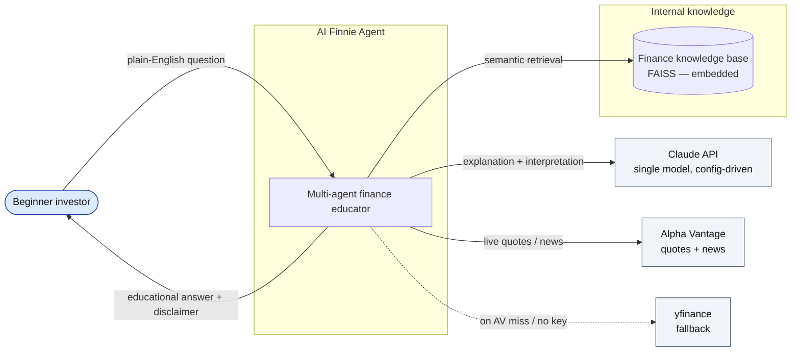
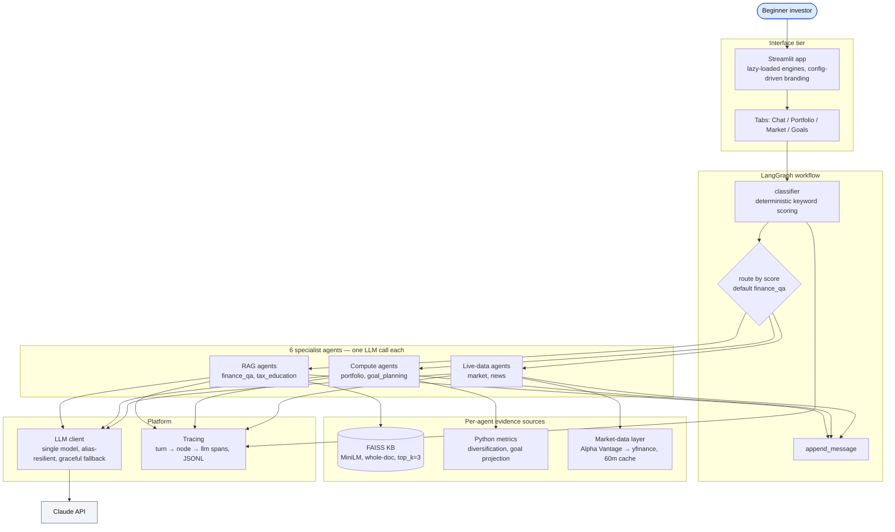
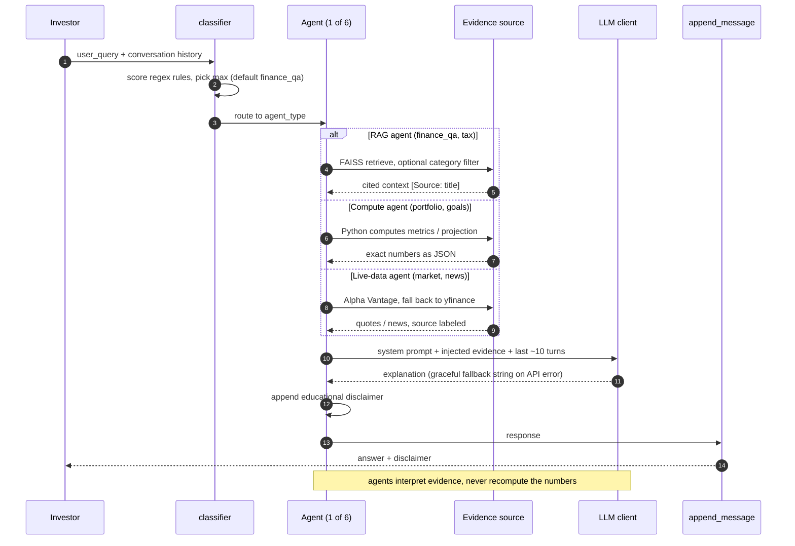
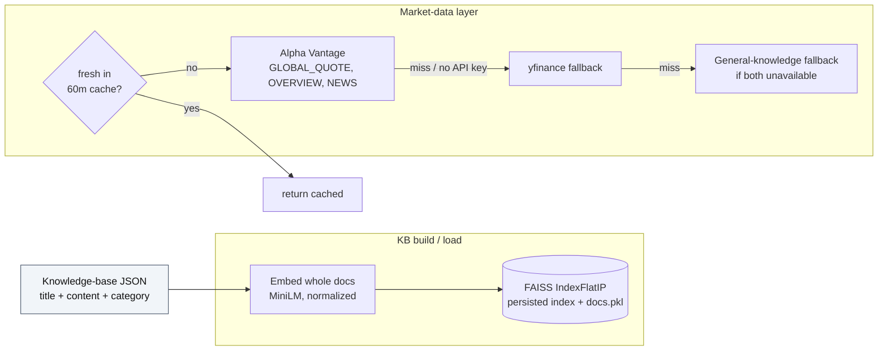

# Architecture Diagram

Three zoom levels (C4-style: context → container → the turn loop), plus the data + market-data
fallback path. Diagrams are Mermaid so they version-control as text and render in-place. This is the
visual companion to [DESIGN.md](DESIGN.md), which carries the rationale for every choice shown here.

## L1 — System context

## L2 — Container view

## L3 — The turn loop (a single question)

## Knowledge base & market-data fallback path

**Reading the diagrams.** Two ideas are visible structurally:

- **Three agent patterns behind one interface** (L2 `AG` subgraph; L3 `alt` branches). *RAG* agents cite
  the knowledge base, *compute* agents run exact Python math the LLM only narrates, and *live-data*
  agents pull real quotes/news with a fallback chain. See [DESIGN.md §2](DESIGN.md) and [§3–5](DESIGN.md).
- **Compute in code, narrate with the model** (L3 note; the `pymath` node). Portfolio metrics and goal
  projections are computed deterministically and the LLM is instructed to interpret, not recompute —
  the project's core defence against confidently-wrong numbers. See [DESIGN.md §3](DESIGN.md).

Two safety properties are also structural: **graceful degradation everywhere** — Alpha Vantage →
yfinance → general knowledge, and an LLM-error fallback string, so a missing API key or provider
outage never hard-fails a turn ([DESIGN.md §5](DESIGN.md)); and an **educational-only posture** — an
advice disclaimer is appended to every answer and agents are prompted away from buy/sell calls
([DESIGN.md §7](DESIGN.md)).
